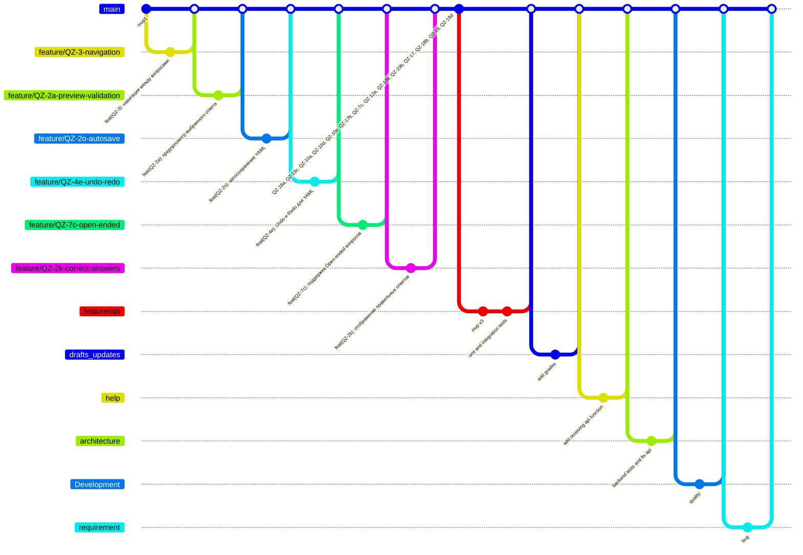

## Development

### Kanban board

We managed our tasks during Sprint 5 using a Kanban board created in Miro.

We followed the Kanban methodology, tracking the progress of each issue across the following columns:

#### Columns and Tasks

| Column         | Tasks                                                                                                                                                      |
|----------------|-------------------------------------------------------------------------------------------------------------------------------------------------------------|
| Backlog        | QZ-12c — Учитывать вес при финальном подсчёте;<br>QZ-19a — Сделать драфт для сохранения квизов;<br>QZ-4j — Обработка ошибок в yaml конструкторе;<br>QZ-11 — Итоговая оценка относительно максимального балла;<br>QZ-9 — SPA-интерфейс. |
| To Do          | Эта колонка пуста на данный момент.                                                                              |
| In Progress    | QZ-19d — Сделать возможность обновлять квизы и вопросы.                  |
| Review         | Эта колонка пуста на данный момент.                                                                              |
| Done - Sprint 3| QZ-3, QZ-17c, QZ-19f, QZ-12b, QZ-2a, QZ-18d, QZ-20b, QZ-18f, QZ-2e, QZ-2h, QZ-4i.                                             |
| Done - Sprint 2| QZ-3, QZ-19e, QZ-19e, QZ-2a, QZ-4e, QZ-4h, QZ-4i, QZ-6b, QZ-7c, QZ-4c, QZ-10c, QZ-10d, QZ-12a, QZ-12a, QZ-17b, QZ-18a, QZ-18b, QZ-18c, QZ-19a, QZ-19b, QZ-19c. |
| Done - Sprint 1| QZ-1, QZ-19, QZ-15b, QZ-7b, QZ-5, QZ-17, QZ-4j, QZ-4a, QZ-4i, QZ-2c, QZ-2f, QZ-2g, QZ-7a, QZ-26.                                |

The Kanban board was updated regularly throughout the sprint and accurately reflected the status of each task.

> Note: The board was maintained in Miro and was not directly linked to the GitLab project.

### Git workflow

We used a customized **GitHub Flow** adapted to our project.

#### Issue Management
- Issues were created from the following predefined templates:
    - [Bug Report Template](./docs/development/issue_templates/bug.md)
    - [Bug Report Template](./docs/development/issue_templates/feature.md)
    - [Task Template](./docs/development/issue_templates/task.md)

- **Labelling:**
    - Labels were used to classify issues: `bug`, `feature`, `task`, `urgent`, `in progress`, `review`, `done`.

- **Assigning:**
    - Each issue was assigned to the responsible developer.

#### Branching
- Branches were created from the latest `main`.
- Naming convention:
    - `feature/<issue-number>-short-description`
    - `bugfix/<issue-number>-short-description`
    - `hotfix/<issue-number>-short-description`

#### Commit Messages
- Format: `#[issue-number] Short, clear message`
- Example: `#14 Fix quiz validation error`

#### Pull Requests
- Pull requests were created using the predefined template: [Pull Request Template](./docs/development/merge_request_template.md)
- Pull requests must:
    - Reference the related issue with `Closes #<issue-number>`
    - Pass all CI checks
    - Be reviewed and approved by at least one reviewer

#### Code Reviews
- Code review was mandatory for all pull requests.
- Reviewers checked:
    - Code quality
    - Coding standards
    - Test coverage

#### Merging
- Only maintainers could merge to `main`.
- Allowed merge strategies: Fast-forward or Squash.

#### Issue Resolution
- Issues were automatically closed when the related pull request was merged.

#### Gitgraph Diagram



### Secrets Management

We followed best practices for secrets management:
- Secrets (API keys, passwords, SSH keys) were never committed to the repository.
- Secrets were stored in:
    - GitLab CI/CD variables
    - Local `.env` files (excluded via `.gitignore`)
- Production secrets were stored on the deployment server and injected securely at runtime.
- Developers were responsible for managing their local environment variables and ensuring secrets remained confidential.


## Build and Deployment

### Continuous Integration

We use GitLab CI/CD for continuous integration. Our CI pipeline is defined in the following file:

- [GitLab CI/CD configuration](./_gitlab-ci.yml)

#### Static Analysis and Testing Tools Used:

| Tool            | Purpose                                             |
|-----------------|----------------------------------------------------|
| Golint          | Static code analysis to check Go code style issues. |
| Staticcheck     | Advanced static analysis for finding potential bugs and performance issues in Go code. |
| golangci-lint   | Comprehensive linting and style checking for Go code. |
| go test         | Runs unit and integration tests to verify the functionality of the application. |

#### CI Workflow Overview:
- **Lint stage:** Runs `golint` to ensure code quality and consistent style.
- **Staticcheck stage:** Runs `staticcheck` to find deeper issues and potential bugs.
- **Build stage:** Compiles the backend Go application.
- **Report stage:** Runs unit and integration tests with coverage reporting.
- **QA stage:** Runs `golangci-lint` for additional code analysis and quality checks.


---

### Continuous Deployment

We also use GitLab CI/CD for continuous deployment of both backend and frontend.

#### CD Workflow Overview:

- **Backend Deployment:**
    - Securely deploys the compiled backend binary to the production server using SSH.
    - Automatically stops any running instance of the backend and restarts the service using the new build.
    - Deployment server IP: `37.220.83.144`

- **Frontend Deployment:**
    - Builds the frontend project using Node.js.
    - Automatically connects to the remote web server via SSH.
    - Clears the existing web files and deploys the new build to `/var/www/html/`.

#### Deployment Configuration:
- Both backend and frontend deployment stages use SSH keys securely provided via GitLab CI/CD variables.
- CI/CD pipeline automatically deploys to production after successful builds and tests.

#### CD Pipeline Files:
The CD stages are defined in the same [GitLab CI/CD configuration file](./_gitlab-ci.yml).


## Architecture

### Static view


> **Sources:**  
> [component-diagram.puml](./docs/architecture/static-view/component-diagram.puml)

**Coupling (Dependencies between modules):**

- **Frontend and Backend:**  
  Loosely coupled – they communicate only via REST API. This simplifies independent testing and deployment.

- **Backend and Database:**  
  More tightly coupled. The `DB` layer in Go interacts directly with PostgreSQL.

- **Inside the Backend:**  
  The `Handlers`, `Models`, and `DB` packages are interconnected:
    - `Handlers` depend on `Models` and `DB`.
    - `DB` handles all database queries.
    - `Models` define data structures shared across components.

---

**Cohesion (Internal consistency of modules):**

- **Frontend (React):**
    - `components`: high cohesion – focused purely on UI rendering.
    - `services`: handles API communication and authentication logic.
    - `context`: manages global application state.

- **Backend (Go):**
    - `Handlers`: only HTTP request handlers.
    - `Models`: only entity definitions.
    - `DB`: only database operations.
    - The high cohesion of each package improves modularity.

---

**Design decisions and maintainability:**

- We deliberately chose REST API as the only integration layer between frontend and backend to reduce coupling.
- Using clearly separated packages and layers improves readability and maintainability.
- High cohesion within modules and loose coupling between layers allows:
    - Independent frontend and backend evolution.
    - Easier testing.
    - Long-term maintainability of the codebase.


### Deployment view


#### Deployment Comments

- The backend and database run on the same remote Linux server.
- Nginx serves static React files and proxies API calls to the Go server.
- All communication is secured with HTTPS via Nginx.
- This setup simplifies deployment while maintaining separation of concerns.
- Customers do not need to host any components themselves.
#### Deployment Process

1. **Build the React app**  
   Run:
   npm run build
2. **Copy the build files to the server**

   Destination: /var/www/html

3. **Deploy the Go backend binary**

   Place the compiled Go binary on the server

   Set up a systemd service for automatic start

4. **Configure Nginx**

   Serve static files from /var/www/html

   Proxy /api/ requests to the Go server

5. **Configure HTTPS certificates**

   Use Let’s Encrypt or another certificate provider

6. **Start services**

Start Nginx

Start the Go backend service


### Dynamic view

This dynamic view describes the scenario where a student submits their quiz answers through the application.  
Execution time: 0.863 ms
The process involves multiple components and transactions:

- **Frontend React Application**
- **Go REST API Backend**
- **PostgreSQL Database**

> **Sources:**  
>[dynamic_uml.puml](./docs/architecture/dynamic-view/dynamic_uml.puml)

---

## Quality assurance

### User acceptance tests
[User acceptance tests](./docs/quality-assurance/user-acceptance-tests.md)

### Quality attribute scenarios
[Quality attribute scenarios](./docs/quality-assurance/quality-attribute-scenarios.md)

### Automated tests

The project implements an automatic testing system for both the frontend and the backend.

#### Tools:
- `go test` — for unit and integration tests of the backend (Gin, PostgreSQL)
- `jest` + `@testing-library/react` — for component and integration tests of React frontend
- `React Testing Library` — for usability and UX testing
- `MemoryRouter` — for tests with routing
- `setupTests.js` — Setting up an environment for Jest


### Tests in `quiz_test.go`

#### Unit tests (isolated checking of conditions and errors):
1. `TestCreateQuiz` — successful creation of a quiz
2. `TestGetQuizByID` — getting a quiz by ID
3. `TestGetQuizByID_NotFound` — 404 when requesting a non-existent quiz
4. `TestCreateQuiz_MissingTitle` — 400 if there is no header
5. `TestCreateQuiz_InvalidDate` — 400 for invalid date
6. `TestCreateQuiz_MissingBody` — 400 if request body is empty
7. `TestCreateQuiz_MissingUserID` — 400 if userID is missing
8. `TestCreateQuiz_EndDateBeforeStartDate` — 400 if the deadline is before the start
9. `TestGetQuizByID_InvalidID` — 400 for non-numeric ID

#### Integration tests (full scenario):
1. `TestIntegration_CreateAndDeleteQuiz` — creating and deleting a quiz
2. `TestIntegration_CreateAndRetrieveQuiz` — creation + receipt
3. `TestIntegration_CreateUpdateRetrieveQuiz` — full CRUD
4. `TestIntegration_CreateQuiz_InvalidStateID` — stateid check
5. `TestIntegration_CreateMultipleAndListQuizzes` — creating two quizzes and outputting a list

---

### Frontend Tests

| File                                       | What does it check?                                                  |
|--------------------------------------------|----------------------------------------------------------------------|
| `Quiz.integration.test.js`                 | Full cycle: answer selection → submit → display rating               |
| `EditorForQuestion.test.js`                | Редактирование текста вопроса, обновление состояния                  |
| `EditorForQuestion.integration.delete.test.js` | Editing question text, updating status                           |
| `MatchingQuestions.integration.test.js`    | Display all pairs in the question "for matching"                     |
| `Api.test.js`                              | Transforming data before sending to the server                       |
| `LoginPage.integration.test.js`            | Successful user authorization                                        |
| `LoginPage.integration.error.test.js`      | Display error when login is incorrect                                |
| `time.test.js`                             | Correct conversion of deadline time in UTC/MSK format                |

---

#### CI and autostart:

Tests can be run locally via:
- `go test ./...` for backend
- `npm test` or `yarn test` for frontend

--- 

### 1. Cloning a repository

```bash
git clone https://gitlab.com/arthuraipov-group/AntiMoodlo.git
cd quiz-platform
```

## Usage

### 1. Link to project website

[Link](http://37.220.83.144)

### 2. Login Credentials

#### Student
- Username: alice
- Password: password123

#### Teacher
- Username: bob
- Password: secure456

#### Admin
- Username: charlie
- Password: admin789## Usage

### 1. Link to project website

[Link](http://37.220.83.144)

### 2. Login Credentials

#### Student
- Username: alice
- Password: password123

#### Teacher
- Username: bob
- Password: secure456

#### Admin
- Username: charlie
- Password: admin789

